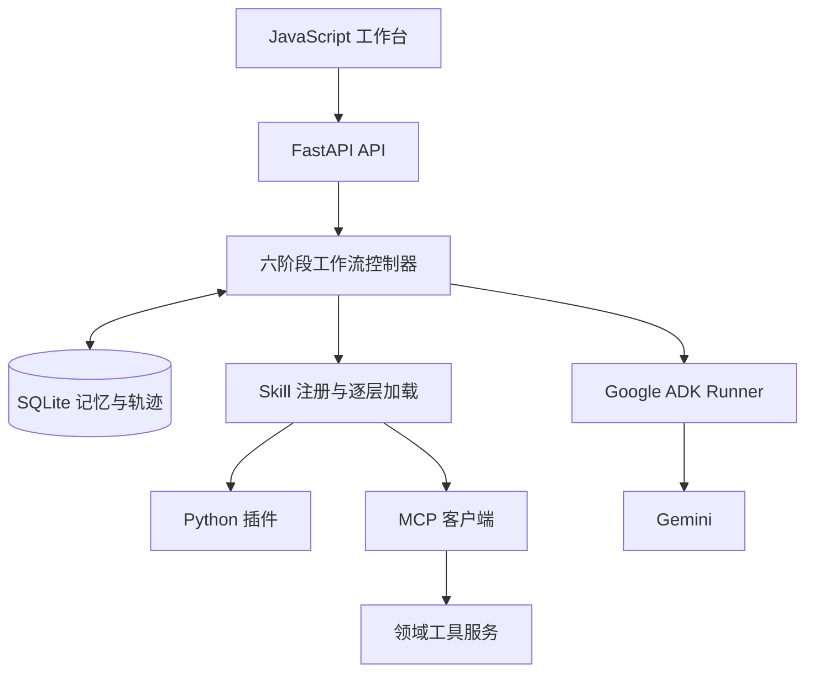

# 架构与算法简述

## 分层架构

FastAPI 接收结构化需求，创建后台异步任务后立即返回 run ID。前端每 750 ms 读取运行状态和累积事件。SQLite 保留事件，可查看历史、导出 JSON。结果用 textContent 渲染，模型文本不会被当作 HTML 执行。单进程任务字典提供会话互斥；并发限制为四个会话。

## 1. 有限阶段循环编排

工作流状态为 `(round, stage, status)`，阶段固定为需求、成分、组织、性能、工艺、决策。控制器从第 1 轮第 1 阶段依序推进，默认到第 2 轮末结束，可设为 3 轮。

每一步读取该 Skill，执行契约检查并保存结果；下一阶段收到近期六个阶段输出。第二轮的初始上下文含第一轮的近期结果，因此未来可以用决策反馈修订候选。本次仅完成调度循环，不含材料优化算法或自行判断收敛。任一阶段异常/超时使运行终止为 failed，保留此前事件；不会把失败结果当作成功继续。

## 2. 逐层披露（Progressive Disclosure）

| 层级 | 加载内容 | 时机 |
|---|---|---|
| L1 | ID、摘要、阶段、状态、传输方式 | 启动注册、任务开始时公开目录 |
| L2 | 仅当前 Skill 的 SKILL.md、输入输出 Schema | 进入对应阶段；模型可通过 load_skill 获取 |
| L3 | 当前 Skill 的执行入口或 MCP 工具 | 输入 Schema 校验成功后；输出再次校验 |

L1 不读取其他 Skill 的正文；详细说明延迟至阶段触发。Google 模式使用两个受阶段白名单限制的 ADK 函数工具。`execute_skill` 必须先 `load_skill`；它返回控制器已经执行的缓存结果，避免重复调用昂贵或有副作用的领域工具。禁止通过模型参数指定任意模块、命令或 MCP URL。插件是由开发者在服务器安装的可信代码，不是沙箱。

这是基于阶段匹配的确定性路由，复杂度约 O(R×S)，其中 R 为轮数、S=6；不是向量检索，也不是自主生成工作流图。优点是行为透明、演示可复现、上下文按需注入。

## 3. 记忆算法

短期上下文：最近 8 条用户/助手消息、近期 6 个阶段输出。长期上下文：按 session_id 保存 `requirements` 与 `last_summary`。运行启动先读取旧记忆，再将本次结构化输入写为新的目标；旧记忆不能覆盖当前输入。结束保存简短运行摘要；完整阶段记录单独留在 events/runs 表。

记忆是规则提取和滑动窗口，不包含向量数据库、语义检索或 LLM 摘要。每个用户消息上限 6000 字符，轮数最多 3，模型每阶段最多 6 次 LLM 调用且有超时；未来可进一步引入总 token 预算。使用 SQLite WAL 与独立事务，重启后保留数据。ADK 每阶段新建临时 session，通过显式注入与 SQLite 衔接。

清空当前记忆同时清空对话，避免刚清除的信息通过近期对话再次注入；历史运行不自动回填记忆。会话 ID 隔离只是应用逻辑隔离，未提供用户鉴权。

## 4. 插件与 MCP

统一输入：场景、三项目标、本轮用户文字、轮次、近期阶段结果。统一输出：status、skill_id、data、evidence、warnings。Python 通过管理员预置 entrypoint 加载异步函数；MCP 通过官方 SDK 连接 stdio / Streamable HTTP，调用预配置工具并读取 structuredContent 或 JSON 文本。连接由 AsyncExitStack 在调用后清理。

领域插件缺省为 planned，返回 not_implemented；示例 MCP 服务仅验证协议与契约。当前 MCP 经过 Registry 桥接到控制器，ADK 通过受控函数工具读取结果，没有直接把整个 MCP 服务暴露给模型。

## 5. 后续多目标决策建议（尚未实现）

先硬筛抗拉 >320 MPa、屈服 >180 MPa、伸长率 >12% 以及成分/工艺约束；对未评估的指标标记 unknown，不把缺失值当作零或达标。对已验证可行候选，用公开的指标归一化、用户权重和成本/工艺风险惩罚评分，并保留 Pareto 非支配候选。第二轮针对第一轮的性能短板调整成分或热处理，再重新评估。不同来源、工艺状态和测试条件不可直接混为同一评分。

## 官方接口参考

- Google ADK: https://google.github.io/adk-docs/
- ADK Python: https://github.com/google/adk-python
- ADK MCP: https://google.github.io/adk-docs/tools-custom/mcp-tools/
- MCP Python SDK: https://github.com/modelcontextprotocol/python-sdk/tree/v1.x
